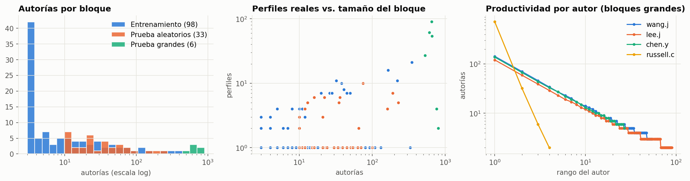
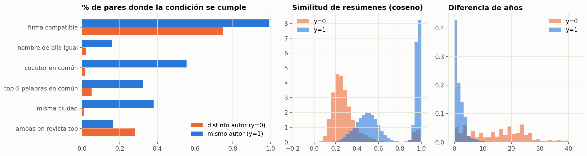
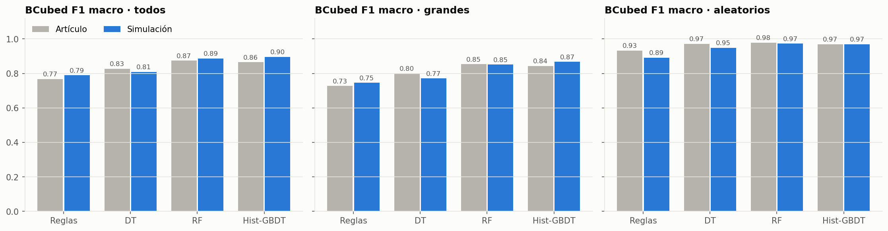
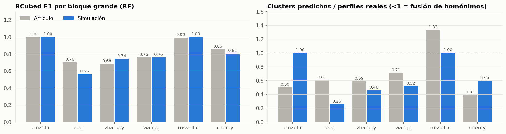
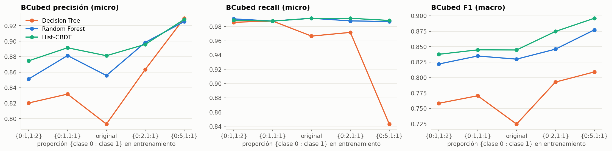
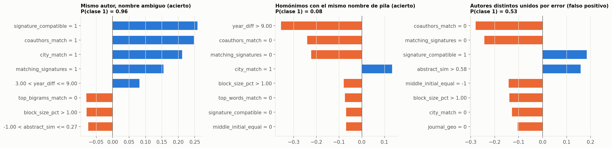
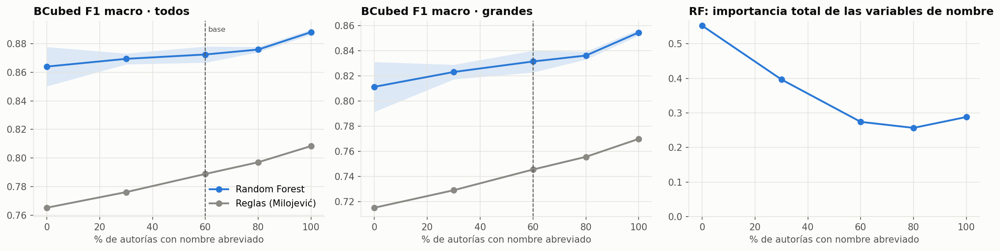

# Desambiguación de autores con aprendizaje supervisado y grafos: recreación con datos simulados

**Actividad final · Machine Learning II** · Maestría en Analítica Aplicada · Universidad de La Sabana · octubre de 2026
**Integrantes:** Laura Almario · Humbert Garrido · Marcela Sánchez

**Artículo recreado:** Mihaljević, H. & Santamaría, L. (2021). *Disambiguation of author entities in ADS using supervised learning and graph theory methods*. Scientometrics, 126, 3893–3917. [doi:10.1007/s11192-021-03951-w](https://doi.org/10.1007/s11192-021-03951-w) (acceso abierto, CC BY 4.0; copia en `references/`).

---

## Resumen

El artículo construye perfiles de autor en la base de datos de astronomía ADS. Para eso agrupa las autorías por *apellido + inicial*, entrena un clasificador que decide si dos autorías son de la misma persona y forma los perfiles detectando comunidades en el grafo resultante (*label propagation*). Nosotros simulamos un conjunto de datos con las características que reporta el artículo y aplicamos el mismo procedimiento: 30 modelos, el grafo, las métricas BCubed y la regla de Milojević como línea base.

| | Artículo | Nuestra simulación |
|---|---|---|
| BCubed F1 macro, mejor Random Forest, todos los bloques de prueba | **0,874** | **0,887** |
| ídem, 6 bloques grandes y homónimos | 0,853 | 0,852 |
| ídem, 33 bloques aleatorios | 0,979 | 0,974 |
| Regla basada en iniciales (Milojević), todos | 0,768 | 0,789 |
| Patrones cualitativos reproducidos | — | 6 de 9 |

**Extensión.** Cambiamos una sola condición: el porcentaje de nombres abreviados (de 0 % a 100 %). Esperábamos que abreviar más empeorara los modelos. Pasó lo contrario: **abreviar todos los nombres mejoró levemente el resultado** (F1 0,872 → 0,889). Lo que más daña es que un mismo autor aparezca escrito en formatos distintos, no la pérdida de información. Esto tiene una consecuencia directa para nuestro trabajo de grado, que integra fuentes con formatos de nombre distintos.

---

## Contenido del repositorio

```
proyecto_ml_final/
├── README.md                     ← este documento: instrucciones y análisis completo
├── requirements.txt              ← dependencias de Python
├── .gitignore
├── notebooks/                    ← análisis (cortos; la lógica está en src/)
│   ├── 01_simulacion_datos.ipynb         pasos 3-4: caracterización, simulación, supuestos, EDA
│   ├── 02_analisis_articulo.ipynb        pasos 5-6: 30 modelos, grafo, BCubed, comparación, LIME
│   └── 03_extension_experimental.ipynb   paso 7: extensión (nombres abreviados)
├── src/                          ← funciones de apoyo
│   ├── config.py        cifras del artículo y TODOS los parámetros (marcados [ARTÍCULO]/[SUPUESTO]/[ESCALADO])
│   ├── names.py         nombres, abreviaturas, firmas y compatibilidad de firmas
│   ├── simulation.py    modelo generativo de autores y autorías
│   ├── features.py      26 variables de comparación por par (Tabla 2 del artículo)
│   ├── models.py        DT / RF / Hist-GBDT, proporciones de clase, búsqueda de hiperparámetros
│   ├── clustering.py    grafo + label propagation; regla de Milojević
│   ├── metrics.py       BCubed por bloque y agregado (micro / macro)
│   ├── pipeline.py      clasificador → grafo → métricas; tablas comparativas
│   ├── explain.py       explicaciones locales tipo LIME
│   └── plots.py         estilo y gráficos comunes
├── data/
│   ├── simulated_authorships.csv   8.034 autorías simuladas (datos de entrada del análisis)
│   ├── block_specs.csv             los 137 bloques: tamaño, nº de autores, origen, exponente Zipf
│   └── processed/                  caché de pares (~120 MB, no se versiona, se regenera)
├── results/                      ← tablas (CSV/JSON); el prefijo indica el notebook que las genera
├── figures/                      ← gráficos (PNG); mismo prefijo
├── references/
    ├── Mihaljevic_Santamaria_2021_Scientometrics.pdf   artículo
    └── Enunciado_Actividad_Final_MLII.pdf              enunciado de la actividad
```

**Columnas de `data/simulated_authorships.csv`.** Las que ve el modelo son: `block`, `name`, `first_part`, `middle_part`, `signature`, `affiliation`, `cities`, `countries`, `year`, `journal`, `title`, `abstract`, `keywords`, `acronyms` y `coauthors`. La etiqueta es `author_id`: el autor real, que solo se usa para formar `y` y para evaluar. Las columnas `latent_*` y `u_*` son internas de la simulación (el nombre canónico y los números aleatorios fijos que usa la extensión) y **nunca** entran al modelo. Los textos están escritos con un vocabulario sintético de pseudopalabras: lo que importa es qué palabras comparten dos autorías, no su significado.

## Cómo ejecutar

```bash
git clone <url-del-repositorio> && cd proyecto_ml_final
python -m venv .venv && source .venv/bin/activate      # opcional
pip install -r requirements.txt
cd notebooks
jupyter nbconvert --to notebook --execute --inplace 01_simulacion_datos.ipynb        
jupyter nbconvert --to notebook --execute --inplace 02_analisis_articulo.ipynb       
jupyter nbconvert --to notebook --execute --inplace 03_extension_experimental.ipynb  
```

También se pueden abrir en Jupyter y ejecutar en orden. Todo es determinista (semilla 2021): una nueva ejecución reproduce las mismas tablas y figuras. Se probó con Python 3.13, scikit-learn 1.9 y NetworkX 3.6 (Python ≥ 3.10 debería funcionar). La simulación completa se genera en el notebook 01. Para recrear el experimento del artículo con las 200 iteraciones de búsqueda originales, basta cambiar `N_ITER_SEARCH` en `src/config.py`.

---

## 1. Selección del artículo y relación con el trabajo de grado

Nuestro trabajo de grado analiza la producción y la visibilidad académica de la investigación del Banco de la República. Para eso integra fuentes heterogéneas: DSpace, RePEc, OpenAlex y Crossref. Cualquier indicador por investigador (producción, citas, redes de coautoría) exige saber qué registros pertenecen a la misma persona. Los nombres abreviados o escritos de distintas formas (“J. Pérez”, “Pérez, J. A.”, “Juan Andrés Pérez”) producen dos errores:

* **fusión:** varios homónimos quedan en un solo perfil, lo que infla los indicadores;
* **fractura:** un mismo autor queda repartido en varios perfiles, lo que los subestima.

El artículo resuelve exactamente ese problema con herramientas del curso: clasificación supervisada con árboles y ensambles, manejo del desbalanceo, validación cruzada por grupos y métricas de precisión y recall. Además usa datos tabulares derivados de metadatos bibliográficos y está publicado en una revista indexada (Scientometrics, Q1).

## 2. Comprensión del estudio

**Objetivo.** Crear perfiles de autor en ADS (SAO/NASA Astrophysics Data System), una base que no ofrece perfiles y en la que la mayoría de nombres de pila aparece abreviada. Se busca un procedimiento de baja complejidad, interpretable y que necesite pocos datos etiquetados.

**Metodología** (Fig. 1 y 2 del artículo):

1. **Bloqueo.** Se agrupan las autorías por apellido + primera inicial, sin diacríticos y en minúsculas (`sorensen.l`). Las comparaciones se hacen solo dentro de cada bloque: comparar todas contra todas costaría O(n²) sobre 3,7 millones de autorías.
2. **Variables por par** (Tabla 2): igualdad, Jaro-Winkler y fonética del nombre; compatibilidad de firmas; similitud de afiliación y coincidencia de país y ciudad (extraídos con NER y GeoNames); tipo de revista; diferencia de años; palabras, bigramas y acrónimos comunes; similitud Doc2Vec de título y resumen; palabras clave y coautores comunes; tamaño del bloque.
3. **Clasificadores de árbol:** Decision Tree, Random Forest e Hist-GBDT, elegidos por la mezcla de variables no numéricas y las interacciones no lineales.
4. **Cinco proporciones de clases** en entrenamiento (original, {0:1,1:1}, {0:2,1:1}, {0:1,1:2}, {0:5,1:1}) y **dos funciones objetivo** (accuracy y average precision), con búsqueda aleatoria de 200 iteraciones y validación cruzada de 5 particiones. En total, 30 modelos.
5. **Grafo y comunidades.** Cada autoría es un nodo. Hay una arista si el clasificador predice “mismo autor”, con peso igual a la probabilidad. Los perfiles se obtienen con *label propagation* asíncrono, que no necesita conocer el número de autores ni hiperparámetros.
6. **Evaluación** con métricas **BCubed** frente a 39 bloques etiquetados a mano, en comparación con la regla híbrida de Milojević (2013).
7. **Interpretación** de pares individuales con LIME.

**Resultados principales.** El mejor modelo es un Random Forest entrenado con 5 veces más pares de clase 0 que de clase 1: BCubed F1 de 0,947 (micro) y 0,874 (macro). Todos los modelos superan a la regla. El desempeño cae en los bloques grandes de apellidos chinos (fusión de homónimos) y es casi perfecto en los bloques aleatorios. La proporción de clases influye más que la función objetivo.

> **Nota sobre la nomenclatura.** El artículo llama *micro* al promedio de los BCubed calculados por bloque y *macro* al cálculo con todas las autorías juntas, al revés del uso habitual en ML. Respetamos su nomenclatura para poder comparar.

## 3. Caracterización de los datos

| Característica | Lo que reporta el artículo |
|---|---|
| Población | Base *Astronomy* de ADS, snapshot de marzo de 2018: 924.329 documentos, 3.667.321 autorías |
| Unidad de análisis / de modelado | autoría / **par de autorías** dentro de un bloque |
| Variable objetivo | `y = 1` si ambas autorías son de la misma persona |
| Bloques | 166.545 con ≥ 2 autorías; media 21, desviación ≈ 50; el mayor es `wang.j` (2.170) |
| Muestra etiquetada | 137 bloques, 14.054 autorías (84,4 % etiquetadas) |
| Entrenamiento | 98 bloques, 2.487 autorías (mediana 5 por bloque), 204.299 pares, **64,9 % clase 1** |
| Prueba | 39 bloques (6 grandes + 33 aleatorios), 9.545 autorías etiquetadas, 562 perfiles, 5,5 M de pares, **47,0 % clase 1** |
| Cobertura de campos (Tabla 1) | autor, año, revista y coautores 100 %; título 99,9 %; resumen 78,7 %; afiliación 78 %; palabras clave 65,3 % |
| Detalle por bloque de prueba | Tabla 7 (6 grandes) y Tabla 9 (33 aleatorios): autorías y perfiles reales de cada bloque |

## 4. Simulación de los datos

Todo el código está en `src/simulation.py`. Los parámetros están en `src/config.py`, cada uno etiquetado como `[ARTÍCULO]`, `[SUPUESTO]` o `[ESCALADO]`.

**Modelo generativo.**

1. **Bloques.** Los 39 bloques de prueba usan el **nombre, el número de autorías y el número de perfiles exactos** de las Tablas 7 y 9; los 6 grandes se escalan a la mitad. Los 98 de entrenamiento siguen una lognormal ajustada a la mediana (5) y al total (2.487) de la Tabla 3.
2. **Productividad.** Las autorías de cada bloque se reparten entre sus autores con una ley de Zipf. El exponente se **calibra** para reproducir el porcentaje de pares de clase 1 de la Tabla 3.
3. **Autores.** Cada autor tiene un nombre canónico (pools de nombres occidentales y de sílabas chinas y coreanas, que generan homónimos), instituciones con posible cambio a mitad de carrera, temas de investigación, frases y acrónimos propios, un grupo habitual de coautores, revistas preferidas y años activos.
4. **Autorías.** Cada autoría hereda los atributos de su autor con ruido: el nombre aparece completo o abreviado (“Wang, J.-C.”, “Wang, Jiancheng”), puede firmar desde otra institución, tener coautores nuevos o formar parte de una gran colaboración. Los campos faltan según la Tabla 1.
5. **Variables por par.** Se calculan a partir de los campos *observados*, igual que en el artículo (26 variables, `src/features.py`). En lugar de Doc2Vec se usa LSA (TF-IDF + SVD de 25 dimensiones).

**Resultado: la simulación reproduce lo reportado** (`results/01_tabla3_articulo_vs_simulacion.csv`):

| | Artículo | Simulación |
|---|---|---|
| Bloques de entrenamiento / prueba grandes / prueba aleatorios | 98 / 6 / 33 | 98 / 6 / 33 |
| Autorías por bloque (mediana): entrenamiento / aleatorios | 5 / 24 | 5 / 24 |
| Perfiles por bloque (media): entrenamiento / aleatorios | 2,6 / 2,6 | 2,6 / 2,6 |
| % de pares de clase 1: entrenamiento / grandes / aleatorios | 64,9 / 46,5 / 77,4 | 64,9 / 46,5 / 77,2 |
| Pares de prueba | 5.503.931 | 1.435.640 (bloques grandes a la mitad) |
| Cobertura de resumen / afiliación / palabras clave | 78,7 / 78 / 65,3 % | 78,7 / 78,0 / 65,1 % |

**Supuestos** (lista completa en `results/01_supuestos_simulacion.csv`). Los más importantes:

| Supuesto | Por qué |
|---|---|
| Bloques grandes a la mitad (autorías y perfiles) | 5,4 M de pares no caben en un portátil; se conserva la razón autorías/perfil |
| `binzel.r` y `russell.c` dominados por un autor (99 % y 90 % de pares clase 1) | En la Tabla 7 el RF los resuelve casi perfecto con 1 y 12 clusters |
| 60 % de autorías con el nombre abreviado | El artículo solo dice “la mayoría” |
| 75 % de nombres asiáticos de dos sílabas; 95 % conserva la 2.ª inicial al abreviar | No reportado; define la ambigüedad de los bloques chinos y coreanos |
| 45 % de autores occidentales con segundo nombre | No reportado; define cuándo la regla de Milojević separa |
| 35 % cambia de institución; 10 % firma como visitante; 15 % con doble afiliación; 10 % de fallos del NER | Movilidad y ruido de extracción no reportados |
| 3 % de autorías en colaboraciones de 100–300 autores | El artículo menciona más de 1.600 documentos con más de 100 autores |
| 35 % de homónimos comparten subárea; 65 % de autores asiáticos en su país | Genera los casos difíciles (mismo tema, misma institución) |
| LSA de 25 dimensiones en lugar de Doc2Vec; vocabulario sintético | No hay texto real |
| Solo autorías etiquetadas | Las no etiquetadas no se usan ni para entrenar ni para evaluar |



Una misma forma de nombre corresponde a muchas personas. En `wang.j`, la forma “Wang, J.” aparece en 99 autorías de 15 autores distintos. Por eso **el nombre por sí solo no basta**: la firma es compatible en casi todos los pares del mismo autor, pero también en la mayoría de pares de autores distintos. Coautores, ciudad, contenido y cercanía en años separan mucho mejor las clases:



## 5. Recreación del análisis

| Etapa | Artículo | Recreación |
|---|---|---|
| Bloqueo | apellido + inicial | igual |
| Variables | Tabla 2 | 26 equivalentes; Metaphone en lugar de Double Metaphone; LSA en lugar de Doc2Vec |
| Partición | por bloques, 98 / 39 | igual |
| Clasificadores | DT, RF, Hist-GBDT | igual (scikit-learn) |
| Proporciones de clase | 5, por submuestreo | igual |
| Búsqueda de hiperparámetros | aleatoria, 200 iteraciones, CV 5 | aleatoria, 10 iteraciones, `GroupKFold(5)` por bloque, sobre una muestra de ≤ 40 mil pares; el modelo final se reentrena con todos los pares |
| Funciones objetivo | accuracy, average precision → 30 modelos | igual → 30 modelos |
| Perfiles | grafo (arista si p ≥ 0,5, peso p) + label propagation asíncrono | igual (NetworkX) |
| Métricas | BCubed micro / macro por subconjunto; reporte de pares | igual |
| Línea base | regla híbrida de Milojević | igual |
| Interpretación | LIME | implementación propia del principio de LIME (el paquete no compila en Python 3.13) |

El notebook 02 entrena los 30 modelos (`results/02_hiperparametros_30_modelos.csv`), construye los perfiles y evalúa cada uno (`results/02_bcubed_30_modelos.csv`).

## 6. Comparación con el artículo

**Mejor configuración de cada algoritmo** (criterio del artículo: mayor BCubed F1 macro), `results/02_comparacion_articulo_vs_simulacion.csv`:

| Subconjunto | Modelo | F1 micro art. | F1 micro sim. | Precisión macro art. | Precisión macro sim. | Recall macro art. | Recall macro sim. | **F1 macro art.** | **F1 macro sim.** |
|---|---|---|---|---|---|---|---|---|---|
| Todos | Reglas (Milojević) | 0,890 | 0,870 | 0,963 | 0,706 | 0,638 | 0,893 | 0,768 | 0,789 |
| Todos | Decision Tree | 0,909 | 0,906 | 0,749 | 0,693 | 0,924 | 0,956 | 0,827 | 0,803 |
| Todos | Random Forest | 0,947 | 0,954 | 0,811 | 0,828 | 0,946 | 0,955 | **0,874** | **0,887** |
| Todos | Hist-GBDT | 0,945 | 0,950 | 0,787 | 0,850 | 0,960 | 0,967 | 0,865 | 0,905 |
| Grandes | Reglas (Milojević) | 0,646 | 0,694 | 0,968 | 0,645 | 0,583 | 0,883 | 0,727 | 0,745 |
| Grandes | Random Forest | 0,832 | 0,829 | 0,778 | 0,779 | 0,944 | 0,941 | 0,853 | 0,852 |
| Aleatorios | Reglas (Milojević) | 0,934 | 0,902 | 0,939 | 0,865 | 0,927 | 0,920 | 0,933 | 0,892 |
| Aleatorios | Random Forest | 0,975 | 0,976 | 0,980 | 0,956 | 0,978 | 0,992 | 0,979 | 0,974 |



**Clasificación de pares** (Tabla 5; RF, accuracy, {0:5,1:1}). El clasificador es conservador en ambos casos: la clase 1 tiene precisión muy alta y recall menor.

| | Precisión 0 | Recall 0 | Precisión 1 | Recall 1 | Accuracy |
|---|---|---|---|---|---|
| Artículo | 0,83 | 0,98 | 0,97 | 0,77 | 0,88 |
| Simulación | 0,90 | 0,99 | 0,98 | 0,88 | 0,93 |

**Bloques grandes** (Tabla 7). Los resultados por bloque se parecen mucho, salvo en `lee.j`. En los bloques asiáticos el modelo fusiona homónimos: predice menos clusters que autores reales.



**Efecto de la proporción de clases.** Más pares de clase 1 en entrenamiento producen más recall y menos precisión. Sobrerrepresentar la clase 0 es lo mejor para los ensambles.



**¿En qué se apoya el modelo?** En el RF, los coautores, la segunda inicial, la diferencia de años y la ciudad concentran la importancia. Las explicaciones tipo LIME del bloque `chen.y` muestran los mismos mecanismos que las Tablas 10–13 del artículo. Un par ambiguo de un mismo autor se une gracias a coautores y ciudad comunes. Dos homónimos con el mismo nombre se separan por la distancia en años y la falta de coautores comunes. El error típico es una firma compatible que pesa más que la ausencia de otras coincidencias.



### Patrones del artículo verificados automáticamente (`results/02_patrones_reproducidos.csv`)

| Patrón | ¿Se reproduce? |
|---|---|
| Los 3 modelos de ML superan a la regla de Milojević | ✅ |
| La proporción de clases pesa más que la función objetivo | ✅ |
| Más clase 1 en entrenamiento → más recall y menos precisión | ✅ |
| Los bloques grandes son más difíciles que los aleatorios | ✅ |
| En bloques grandes el RF predice menos clusters que perfiles reales | ✅ |
| En pares: precisión de clase 1 > clase 0 y recall de clase 0 > clase 1 | ✅ |
| Random Forest es el mejor algoritmo | ❌ (gana Hist-GBDT, 0,905 frente a 0,887) |
| {0:5,1:1} es la mejor proporción para los 3 algoritmos | ❌ (sí para RF y Hist-GBDT; DT prefiere {0:2,1:1}) |
| La regla tiene precisión alta y recall bajo en bloques grandes | ❌ (precisión 0,65 frente a 0,97) |

### Posibles razones de las diferencias

1. **RF frente a Hist-GBDT.** En el artículo los separan 0,009 puntos de F1. Con otros datos y una búsqueda de 10 iteraciones (no 200), el orden entre dos modelos tan cercanos no es estable.
2. **La precisión de la regla de Milojević** es el desacuerdo más grande. La explicación más probable es una **selección de los datos etiquetados**: el artículo no logró desambiguar ~20 % de las autorías de los bloques chinos, justo las más ambiguas, y evalúa solo sobre las etiquetadas. Nosotros evaluamos el bloque completo. Además, la precisión de la regla depende de cuántos autores comparten iniciales, un dato que el artículo no reporta y que aquí es un supuesto.
3. **`lee.j` es más difícil en la simulación** (0,55 frente a 0,70) porque el pool de sílabas coreanas simulado genera más homónimos exactos que la realidad.
4. **Simplificaciones de escala y de datos:** bloques grandes a la mitad; texto sintético con LSA; búsqueda de hiperparámetros más corta; movilidad, coautores y temas supuestos.
5. **Observación metodológica.** El artículo elige la mejor configuración de cada algoritmo **mirando el conjunto de prueba** (Tablas 4, 6 y 8), lo cual es optimista. Para las Tablas 5 y 7, LIME y la extensión usamos una configuración fijada de antemano: RF, accuracy, {0:5,1:1}.

## 7. Extensión experimental: nombres abreviados

**Condición modificada (una sola):** el porcentaje de autorías con el nombre de pila abreviado: 0 %, 30 %, **60 % (base)**, 80 % y 100 %.

**Todo lo demás se mantiene fijo:** autores, textos, afiliaciones, coautores, partición, algoritmo e hiperparámetros (RF de referencia). Solo se recalculan las 7 variables de nombre. Para que la comparación sea limpia se usan números aleatorios comunes: cada autoría tiene un número fijo `u_abbr` y se abrevia si `u_abbr < p`. Cada escenario se repite con 3 semillas.

**Por qué esta condición.** La abreviación es la causa del problema en ADS, y las fuentes de nuestro trabajo de grado (DSpace, RePEc, OpenAlex, Crossref) difieren justamente en el formato del nombre: completo, con iniciales, con o sin segundo nombre.

**Hipótesis:** con más nombres abreviados, menor precisión (más fusiones), sobre todo en los bloques homónimos.

| % abreviado | RF F1 macro, todos (media ± d.e.) | RF F1 macro, grandes | Regla F1 macro, todos | Importancia de las variables de nombre (RF) | % de autores con una sola firma |
|---|---|---|---|---|---|
| 0 % | 0,864 ± 0,016 | 0,811 | 0,765 | 0,54 | 40 % |
| 30 % | 0,855 ± 0,011 | 0,803 | 0,776 | 0,38 | 18 % |
| **60 % (base)** | **0,872 ± 0,004** | **0,832** | **0,789** | 0,25 | 21 % |
| 80 % | 0,876 ± 0,004 | 0,837 | 0,797 | 0,24 | 34 % |
| 100 % | 0,889 ± 0,005 | 0,856 | 0,808 | 0,26 | 78 % |



**Resultado: la hipótesis no se cumple.** Pasar del 60 % al 100 % de nombres abreviados *mejora* el F1 del RF en +0,017 (la desviación entre semillas es ≈ 0,005) y el de la regla en +0,020. La mejora se concentra en los bloques asiáticos (`wang.j` 0,74 → 0,81; `chen.y` 0,81 → 0,85).

**Explicación.** Con formatos mezclados, un mismo autor aparece con varias firmas (“Jian-Cheng”, “Jiancheng”, “J.-C.”, “Jian C.”). En el escenario base solo el 21 % de los autores tiene una única firma; con todo abreviado, el 78 %. El modelo deja de fracturar perfiles y la regla deja de partirlos. Cuando faltan nombres completos, el RF desplaza la importancia hacia coautores, ciudad, años y contenido: las fuentes de evidencia son redundantes.

**Límite.** El resultado depende del supuesto de que los nombres completos llegan con variaciones de formato y de que los homónimos asiáticos comparten sílabas. En una base con nombres completos limpios y distintos entre homónimos, el efecto podría invertirse.

## 8. Conclusiones y aprendizaje

**¿Qué logramos recrear?** El procedimiento completo: bloqueo, 26 variables de pares, 3 clasificadores × 5 proporciones × 2 funciones objetivo, validación cruzada por bloque, grafo ponderado, label propagation, BCubed micro y macro, la regla de Milojević y explicaciones locales. Los valores agregados quedaron muy cerca de los del artículo (RF: 0,887 frente a 0,874) y se reprodujeron 6 de los 9 patrones cualitativos.

**¿Qué no fue posible?** Usar texto real y Doc2Vec; extraer país y ciudad con NER y GeoNames; trabajar con la escala real de los bloques grandes y las 200 iteraciones de búsqueda; reproducir la alta precisión de la regla de Milojević (que depende de la estructura real de los nombres y de qué autorías se lograron etiquetar); y obtener el mismo ganador entre RF e Hist-GBDT.

**¿Qué aprendimos del método?**

1. Formular la desambiguación como **clasificación de pares** permite usar todo el arsenal supervisado, pero la unidad de evaluación correcta es el **perfil** (BCubed), no el par. Un clasificador con accuracy de 0,93 todavía fusiona homónimos en los bloques grandes, porque basta una arista equivocada para unir dos comunidades.
2. **El desbalanceo es una decisión de diseño.** Sobrerrepresentar la clase 0 hace al clasificador conservador y reduce las fusiones, que son el error más costoso en el grafo.
3. La **validación por grupos (bloques)** es obligatoria: partir por pares filtraría información entre entrenamiento y prueba.
4. Elegir la configuración **mirando la prueba** sobreestima el desempeño; hay que fijarla con validación.
5. Las métricas de un método basado en reglas dependen fuertemente de la población de nombres. Un artículo que no reporta esa estructura es difícil de replicar.

**¿Cómo afectó la condición experimental?** Abreviar todos los nombres no empeoró los resultados; los mejoró levemente porque homogeniza el formato. La información que se pierde en el nombre la compensan coautores, afiliación y contenido.

**Implicaciones para el trabajo de grado:**

* Antes de calcular indicadores por investigador del Banco de la República hay que desambiguar. Unificar por nombre normalizado produce fusiones y fracturas que sesgan los indicadores.
* **Normalizar el formato de nombre entre fuentes** (por ejemplo, apellido + iniciales) antes de comparar, o comparar siempre al nivel de detalle común. Mezclar nombres completos y abreviados de fuentes distintas es más dañino que abreviar.
* Priorizar **coautores, afiliación y años** como evidencia, y medir antes su cobertura en cada fuente: en la simulación, cuando el nombre informa poco, el modelo se sostiene en esos campos.
* Usar los **identificadores persistentes** (ORCID, RePEc ID, OpenAlex ID) como etiquetas para entrenar y evaluar. Esto reduce el costo del etiquetado manual, que el artículo reconoce como su principal limitación.
* Para la población del Banco, con pocos homónimos, una regla puede ser una buena primera aproximación. Para las fuentes externas, donde abundan los homónimos, se justifica el modelo supervisado.
* Declarar el umbral y la proporción de clases elegidos, porque cambian el balance entre perfiles fusionados y fracturados y, por tanto, los indicadores.

---

## Referencias

* Mihaljević, H. & Santamaría, L. (2021). Disambiguation of author entities in ADS using supervised learning and graph theory methods. *Scientometrics*, 126, 3893–3917. https://doi.org/10.1007/s11192-021-03951-w
* Milojević, S. (2013). Accuracy of simple, initials-based methods for author name disambiguation. *Journal of Informetrics*, 7(4), 767–773.
* Amigó, E. et al. (2009). A comparison of extrinsic clustering evaluation metrics based on formal constraints. *Information Retrieval*, 12(4), 461–486.
* Raghavan, U. N., Albert, R. & Kumara, S. (2007). Near linear time algorithm to detect community structures in large-scale networks. *Physical Review E*, 76(3), 036106.
* Ribeiro, M. T., Singh, S. & Guestrin, C. (2016). “Why should I trust you?”: Explaining the predictions of any classifier. *KDD ’16*, 1135–1144.
